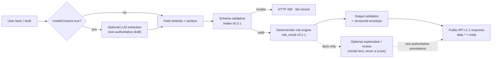

# FlowCredit — Evidence-Aware Risk Workflow + Deterministic Quant Research

[](https://github.com/Anhao1314/flowcredit/actions/workflows/ci.yml)

FlowCredit is two connected tracks over one governance principle — **agent form, deterministic soul**:

1. **Credit-risk agent** (this repository's public product): normalizes supplied business evidence, computes deterministic risk signals, and returns a review status with prioritized next actions. An optional LLM sidecar only extracts, explains and reviews text; the deterministic engine owns every score, grade and decision status. **Listed on Finch (finchtech.ai) — operator-confirmed.**
2. **Quant research stack** (`quant/`): a deterministic signal/backtest/adjudication engine with DSR/PSR correction, an LLM proposal loop, a CoALA-style research memory, a paper/testnet execution path and a local console. It is research infrastructure, not a live trading system.

**Status:** repository release `external-alpha-v0.2.0` · agent `0.4.0` · API `flowcredit.api/v1.1` · engine `flowcredit.risk_result/v0.2.1` · intake `flowcredit.intake/v0.3.1`. The live deployment currently reports `external-alpha-v0.1.1`; updating production is an operator action. Not a calibrated lending system.

## Repository map

| Path | What it is |
| --- | --- |
| `agent/` | Finch-listed risk agent: HTTP service, intake v0.3.1, risk engine v0.2.1, optional LLM harness, contract validators |
| `agent/contracts/` | Machine-readable input/output schemas + representative fixtures |
| `quant/` | Deterministic quant research stack (signal, risk guard, backtest, DSR/PSR, rules, proposals, paper, console, MCP) |
| `quant/research-memory/` | Evidence-derived research memory v0.1: records, knowledge, memory preview |
| `quant/journal/`, `quant/knowledge/` | Episodic (JSONL) and semantic (validated JSON) memory layers |
| `docs/` | Current product/API/Finch docs; `docs/archive/` holds superseded documents |
| `deploy/` | Alternative deployment example (Caddy); production uses Render |

## Architecture & authority boundary



- The model cannot provide or overwrite reserved fields: `TAI`, `CCI`, `riskGrade`, `PD_pct`, `expectedLoss`, `recommendedLimit`, `decisionStatus`.
- Model-extracted allowed business fields still pass schema validation and the deterministic calculation; no textual grounding against the user's original text is implemented.
- `assessmentFingerprint` excludes request metadata (`meta`), session IDs and language-model annotations.

## Credit-risk agent: public API v1.1

| Endpoint | Purpose |
| --- | --- |
| `POST /api/v1/assess` | Deterministic assessment (canonical envelope; optional top-level `meta`) |
| `POST /api/v1/chat` | Natural-language intake → same deterministic runtime |
| `GET /api/v1/schema` | Machine-readable input/output JSON Schemas + versions |
| `GET /api/v1`, `/health`, `/ready` | Discovery, liveness, deterministic readiness (works without the model) |
| `POST /fc/ai/v0.3/*` | Internal compatibility surface (extract/assess/ask/config/schema) |

Legacy v0.1 / v0.2 / v0.2.1 routes and engines were removed in v0.4.0. See the [release notes](docs/releases/external-alpha-v0.2.md) and [contract](docs/finch/CONTRACT.md).

## Quant research stack

- **Deterministic core**: signal engine, pre-trade guard, net-of-cost backtest, Sharpe/MaxDD/turnover, PSR, deflated Sharpe (SSRN 2460551, Eq. 2), effective-trials correction (A.3).
- **Proposal loop**: LLM proposes parameter candidates → schema/bounds/dedup → same-pool adjudication across BTC/ETH → report. Machine never promotes a rule.
- **Research memory v0.1**: adjudication evidence → 14 experiment records (failures retained) → 5 scoped knowledge entries → human-readable preview. Knowledge is injected into proposal prompts; no model calls are made by the memory layer.
- **Execution rehearsal**: local paper engine and Binance Spot testnet adapter (fake funds, per-order human approval; no real capital).
- **Interfaces**: local console (8 views, search, sortable tables), MCP server (7 deterministic tools, no order tools).
- **Honest result so far**: no candidate passes significance (best PSR(0) 0.942 < 0.95); multi-market direction is consistent for 3/4 candidates; calibrated costs (BTC 13.47bps / ETH 15.29bps) are ~2× the frozen 7bps estimate. The system is a falsifier, not a money printer.

## Verified evidence (local, offline)

| Check | Result |
| --- | --- |
| Agent tests (`cd agent && NO_MODEL_ENV=1 npm test`) | **87/87** |
| Quant tests (`cd quant && ls test/*.test.js \| xargs node --test`) | **157/157** |
| Zone isolation lint (`npm run check:quant`) | 0 violations |
| Offline agent evaluation | 30 synthetic cases · 4 injection comparisons · `ONLINE_MODEL=NOT_RUN` ([artifact](agent/eval/results/agent-eval-2026-11-15.json)) |
| Contract validators | `validate:finch-contract` + `validate:public-api` pass |
| Release gate | `verify:release` / `verify:finch-submission` pass in a tree without `.env` (the gate rejects any `.env` file by design) |

## Quick start

Agent (deterministic path needs no model key):

```bash
cd agent
npm ci
npm run check                 # syntax + typecheck + 87 tests
npm run serve                 # http://127.0.0.1:8787 (default)
curl -X POST http://127.0.0.1:8787/api/v1/assess \
  -H 'Content-Type: application/json' --data-binary @contracts/finch-test-input.json
```

Quant (all offline; see `quant/README.md`):

```bash
cd agent
npm run test:quant            # 157 tests
npm run check:quant           # isolation lint
npm run memory                # research memory preview + knowledge
npm run console               # build quant/console/index.html
npm run adjudicate            # deterministic adjudication of candidates.json
npm run serve                 # console + agent on the same local server
```

## Data & licensing

- The Finch agent consumes **supplied** evidence only; it has no bank, billing, identity or on-chain connector.
- Quant market snapshots are frozen local research data. New downloads are gated by a license register: Binance Vision is CC BY-NC-SA 4.0, Coin Metrics is CC BY-NC 4.0, OKX terms are unverified → **no new downloads**; existing snapshots are not redistributed. See [quant/data/LICENSING.md](quant/data/LICENSING.md).

## Limitations & non-goals

- No production credit calibration, no calibrated PD/EL/limit, no automatic lending or transaction decisions, no SLA.
- No live model evaluation (`ONLINE_MODEL=NOT_RUN`); model-extracted fields are not grounded against source text.
- Quant stack has no statistically significant strategy; no real funds; testnet funds are fake.
- Not a general-purpose agent runtime, multi-agent cluster, or trading bot.

## Documentation

- Public API: [docs/public-api-v1.md](docs/public-api-v1.md) · risk rules: [docs/flowcredit-rules-v0.2.1.md](docs/flowcredit-rules-v0.2.1.md) · intake: [docs/flowcredit-intake-v0.3.md](docs/flowcredit-intake-v0.3.md)
- Finch: [CONTRACT](docs/finch/CONTRACT.md) · [SUBMISSION](docs/finch/SUBMISSION.md) · [LISTING](docs/finch/LISTING.md) · [HANDOFF](docs/finch/FINCH_HANDOFF_GUIDE.md)
- Releases: [external-alpha-v0.2.0](docs/releases/external-alpha-v0.2.md) · [v0.1.1](docs/releases/external-alpha-v0.1.1.md)
- Quant: [quant/README.md](quant/README.md) · [research memory](quant/research-memory/README.md) · [licensing](quant/data/LICENSING.md)
- Archive: [docs/archive/](docs/archive)
- [Contributing](CONTRIBUTING.md) · [Security policy](SECURITY.md) · [Changelog](CHANGELOG.md) · [MIT license](LICENSE)

## Hackathon origin

Originated at the Shenzhen–Hong Kong Hackathon and continued as a post-hackathon productization project. The private historical `DEMO.FlowCredit` repository preserves the original simulated interface; this repository is the current project.
