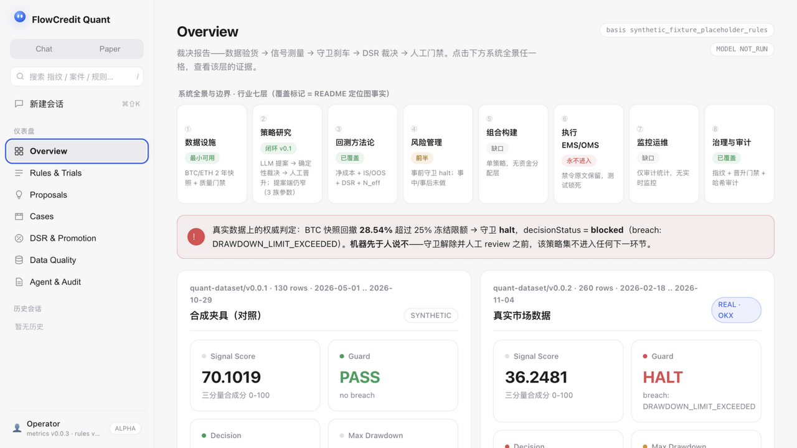
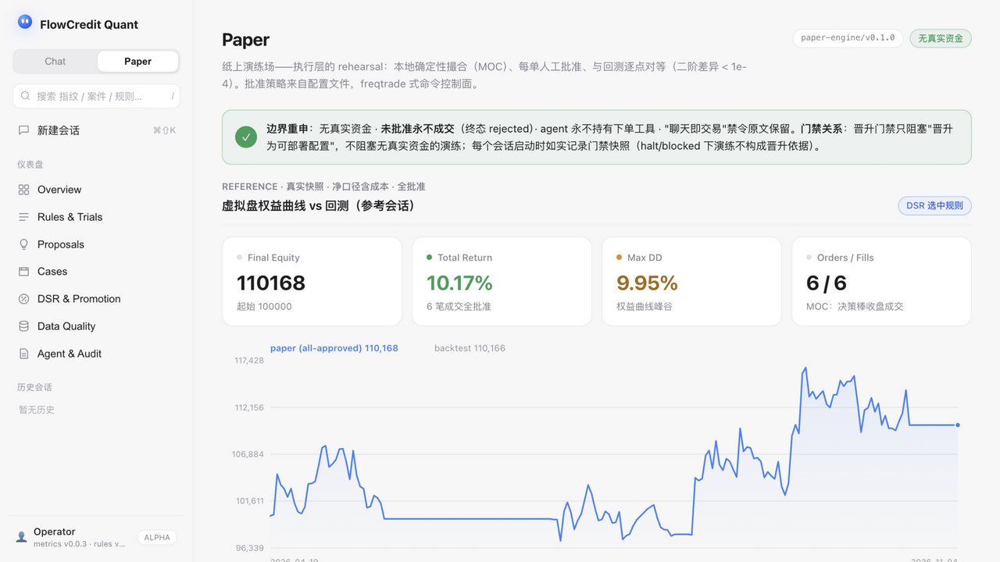
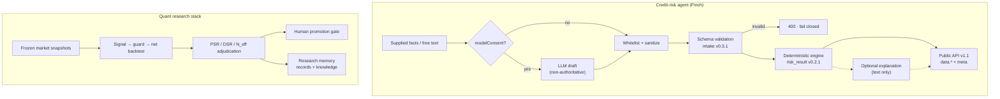

<div align="center">

# FlowCredit

**Evidence-aware credit-risk agent · deterministic quant research stack**

Two tracks, one principle: **agent form, deterministic soul** — the model may talk, the engine decides.

<sub>[English](README.md) · [简体中文](README.zh-CN.md)</sub>

[](https://github.com/Anhao1314/flowcredit/actions/workflows/ci.yml)
[](https://github.com/Anhao1314/flowcredit/releases)
[](docs/public-api-v1.md)
[](LICENSE)

[Listed on Finch](https://finchtech.ai) · [Public API](docs/public-api-v1.md) · [Finch contract](docs/finch/CONTRACT.md) · [Quant stack](quant/README.md) · [Research memory](quant/research-memory/README.md)

</div>

---

## What this is

FlowCredit is a governance-first risk system with two surfaces:

- **A credit-risk agent** (the public product, listed on Finch): it turns supplied business evidence into deterministic risk signals — TAI, CCI, grade, review status — plus the exact list of what to fix or supply next. An optional LLM sidecar extracts and explains text; it never touches a score, grade or decision.
- **A deterministic quant research stack** (`quant/`): signal → guard → net-of-cost backtest → PSR/DSR adjudication → human promotion, with a proposal loop, a CoALA-style research memory, paper/testnet execution and a local console.

The same rule binds both: **authoritative numbers come from pure functions; the model only annotates.**

Shared, zero-business Agent Core primitives now live in [`agent/core/`](agent/core/README.md): one OpenAI-compatible JSON/SSE gateway, a closed tool registry, explicit-policy TTL sessions, checked run projections, common audit events and versioned atomic checkpoints. Credit and quant keep separate product adapters and deterministic engines.

## Status at a glance

| | |
| --- | --- |
| **Repository release** | `external-alpha-v0.2.2` · agent `0.4.2` · API `flowcredit.api/v1.1` |
| **Live deployment** | `external-alpha-v0.1.1` — update to v0.2.1 is a pending operator action |
| **Finch** | Listed on [finchtech.ai](https://finchtech.ai) as *FlowCredit － Business Risk Intelligence* ([agent card](https://www.finchtech.ai/a2a/e96e9a01-50aa-4686-bd0e-1aa9cdfcf967/agent-card.json)) |
| **Risk engine** | `flowcredit.risk_result/v0.2.1` · intake `flowcredit.intake/v0.3.1` |
| **Tests** | 107/107 agent · 157/157 quant · isolation lint 0 violations |
| **Honest headline** | No quant candidate passes significance (best PSR(0) 0.942 < 0.95) — this system is a falsifier, not a money printer |

## Product surface

<p align="center">
  
  
</p>

<p align="center"><sub>Local console: adjudication overview (left) and paper-trading rehearsal with the human approval gate (right).</sub></p>

## Two tracks, one boundary



Both tracks share the same invariants:

1. **Authority boundary** — LLM output never writes authoritative fields.
2. **Human gate** — promotion / signing requires a human; machines never self-promote.
3. **Auditability** — fingerprints, eval IDs, append-only journals, evidence locators.
4. **No execution layer** — no EMS/OMS, no real funds; testnet funds are fake.
5. **Honest disclosure** — missing evidence is reported as missing, not invented.

## Track 1 · Credit-risk agent

### Public API v1.1

| Endpoint | Purpose |
| --- | --- |
| `POST /api/v1/assess` | Deterministic assessment · canonical envelope · optional `meta` |
| `POST /api/v1/chat` | Natural-language intake → same deterministic runtime |
| `GET /api/v1/schema` | Machine-readable input/output JSON Schemas + versions |
| `GET /api/v1` · `/health` · `/ready` | Discovery, liveness, deterministic readiness (works without the model) |
| `POST /fc/ai/v0.3/*` | Internal compatibility surface |

```http
POST https://flowcredit-api.onrender.com/api/v1/assess
Authorization: Bearer <FLOWCREDIT_API_KEY>
Content-Type: application/json
Idempotency-Key: <optional-client-key>
```

<details>
<summary><b>Canonical response shape</b></summary>

```json
{
  "ok": true,
  "apiVersion": "flowcredit.api/v1.1",
  "schemaVersion": "flowcredit.risk_result/v0.2.1",
  "requestId": "fc-example",
  "timestamp": "2026-09-10T00:00:00.000Z",
  "data": {
    "TAI": 93.8,
    "CCI": 929,
    "riskGrade": "A",
    "decisionStatus": "enhanced-review",
    "readinessStatus": "ready",
    "inputFingerprint": "sha256:…",
    "assessmentFingerprint": "sha256:…"
  },
  "meta": {
    "release": "external-alpha-v0.2.2",
    "engine": "flowcredit.risk_result/v0.2.1",
    "intake": "flowcredit.intake/v0.3.1",
    "modelLayer": { "used": false }
  }
}
```

`meta` is envelope metadata, excluded from `assessmentFingerprint`, and safe for v1 clients to ignore.

</details>

### What the engine computes

```text
TAI (0–100)  = reconciliation×10% + validity×35% + physical×25%
             + commercial×20% + continuity×10%

CCI (0–1000) = round((TAI×40% + repayment×25% + customer×15%
               + economics×10% + continuity×10%) × 10)
```

Missing required components produce `null` instead of redistributing weight. `PD_pct`, `expectedLoss` and `recommendedLimit` stay `null` — the system does not approve loans, size credit or execute transactions.

### What it refuses to do

| Refusal | Enforcement |
| --- | --- |
| Let the model write scores / grades / decisions | Field whitelist + sanitizer + JSON Schema, test-locked |
| Invent missing evidence | Non-computable values stay `null`, reported honestly |
| Approve or reject credit automatically | No such output field exists |
| Run without the model | Deterministic path and `/ready` are model-independent |
| Expose stack traces | Canonical error envelope only |

## Track 2 · Deterministic quant research stack

| Layer | Capability |
| --- | --- |
| **Core** | Signal engine · pre-trade guard · net-of-cost backtest · Sharpe / MaxDD / turnover |
| **Adjudication** | PSR · deflated Sharpe (SSRN 2460551, Eq. 2) · effective trials (A.3) · segment robustness |
| **Proposal loop** | LLM candidates → bounds / dedup → same-pool multi-market adjudication → report |
| **Memory** | Episodic journal (JSONL) · semantic knowledge (validated) · evidence-derived records + preview |
| **Execution rehearsal** | Local paper engine · Binance Spot **testnet** adapter · per-order human approval |
| **Interfaces** | Local console (8 views, search, sortable tables) · MCP server (7 tools, no order tools) |

### Where the research stands

| Metric | Result | Threshold |
| --- | --- | --- |
| Best PSR(0) | **0.942** (ETH) | ≥ 0.95 · ✗ |
| Cross-market direction | 3/4 candidates consistent | 4/4 · ✗ |
| Segment robustness | positive ratio 0.50–0.75 | ≥ 0.75 everywhere · ✗ |
| Calibrated cost | BTC 13.47 bps · ETH 15.29 bps | frozen 7 bps was ~2× optimistic |

All failures are retained in the research memory — the system's job is to prove what does **not** work, quickly and auditably.

## Verification

| Check | Result |
| --- | --- |
| Agent tests | **107/107** |
| Quant tests | **157/157** |
| Isolation lint | **0 violations** (62 files) |
| Contract validators | `validate:public-api` · `validate:finch-contract` pass |
| Release gates | `verify:release` · `verify:finch-submission` pass in a `.env`-free tree |
| Offline agent evaluation | 30 synthetic cases · 4 injection comparisons · `ONLINE_MODEL=NOT_RUN` |

## Quick start

**Agent** (deterministic path needs no model key):

```bash
cd agent
npm ci
npm run check          # syntax + typecheck + 107 tests
npm start              # http://127.0.0.1:8787

curl -X POST http://127.0.0.1:8787/api/v1/assess \
  -H 'Content-Type: application/json' \
  --data-binary @contracts/finch-test-input.json
```

**Quant stack** (offline; full guide in [`quant/README.md`](quant/README.md)):

```bash
cd agent
npm run test:quant     # 157 tests
npm run check:quant    # isolation lint
npm run memory         # research memory preview + knowledge
npm run console        # build quant/console/index.html
npm run adjudicate     # deterministic adjudication
```

## Repository map

| Path | Contents |
| --- | --- |
| `agent/` | Finch agent: HTTP service, intake, risk engine, optional LLM harness, validators |
| `agent/contracts/` | Input/output JSON Schemas + representative fixtures |
| `quant/` | Deterministic research stack (signal → guard → backtest → adjudication → paper/MCP/console) |
| `quant/research-memory/` | Evidence-derived memory: records, knowledge, `memory-preview.md` |
| `quant/journal/`, `quant/knowledge/` | Episodic (append-only JSONL) and semantic (validated JSON) memory |
| `docs/` | Current docs · `docs/archive/` superseded material · `docs/finch/` submission package |
| `deploy/` | Alternative deployment example (production uses Render) |

## Data & licensing

- The agent consumes **supplied** evidence only — no bank, billing, identity or on-chain connectors.
- Quant market data is frozen local research data. New downloads are gated by a license register: Binance Vision **CC BY-NC-SA 4.0**, Coin Metrics **CC BY-NC 4.0**, OKX terms unverified → **no new downloads**; existing snapshots are not redistributed. See [`quant/data/LICENSING.md`](quant/data/LICENSING.md).

## Limitations

- No production credit calibration, no calibrated PD / expected loss / numeric limit, no SLA.
- No live model evaluation (`ONLINE_MODEL=NOT_RUN`). Free-text extraction is now grounded: fields without support in the supplied text are dropped before validation. JSON intake has no source text and relies on caller-supplied fields; evidence status is disclosed separately (`evidenceStatus`, `basis: declared_only`, no independently verified evidence yet).
- Quant: no statistically significant strategy; no real funds; testnet money is fake.
- Not a general-purpose agent runtime, multi-agent cluster, or trading bot.

## Documentation

| | |
| --- | --- |
| API & rules | [Public API](docs/public-api-v1.md) · [risk rules v0.2.1](docs/flowcredit-rules-v0.2.1.md) · [intake v0.3](docs/flowcredit-intake-v0.3.md) |
| Finch | [Contract](docs/finch/CONTRACT.md) · [Submission](docs/finch/SUBMISSION.md) · [Listing copy](docs/finch/LISTING.md) · [Handoff guide](docs/finch/FINCH_HANDOFF_GUIDE.md) |
| Releases | [external-alpha-v0.2.2](docs/releases/external-alpha-v0.2.2.md) · [v0.1.1](docs/releases/external-alpha-v0.1.1.md) |
| Product | [Enterprise PRD v0.1](docs/product/enterprise-prd-v0.1.md) · [Design Partner candidates](docs/product/design-partner-candidates-v0.1.md) |
| Quant | [Quant stack](quant/README.md) · [Research memory](quant/research-memory/README.md) · [Licensing](quant/data/LICENSING.md) |
| Contributions | [Contributing](CONTRIBUTING.md) · [Security](SECURITY.md) · [Changelog](CHANGELOG.md) · [Archive](docs/archive) |

## Origin

Originated at the Shenzhen–Hong Kong Hackathon and continued as a post-hackathon productization project. The private historical `DEMO.FlowCredit` repository preserves the original simulated interface; this repository is the current project.

<div align="center">

**MIT licensed** · Built with a bias toward evidence over enthusiasm.

</div>
