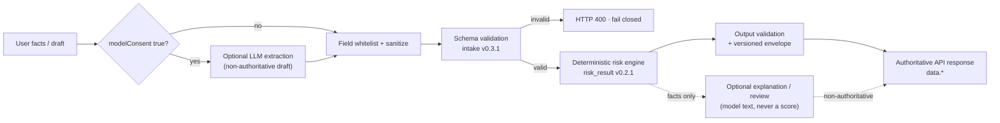

# FlowCredit — Evidence-Aware Risk Workflow with a Constrained LLM Sidecar

[](https://github.com/Anhao1314/flowcredit/actions/workflows/ci.yml)

FlowCredit is a vertical **Evidence → Risk → Action** risk workflow: it normalizes supplied business evidence, computes deterministic risk signals, and returns a review status with prioritized follow-up actions. An optional LLM sidecar (a service that calls DeepSeek for text tasks) assists only with extraction, explanation and text review; the deterministic rule engine owns the authoritative results.

**Status:** External Alpha `v0.1.1` — experimental, not a calibrated lending system. This is a vertical business workflow, not a general-purpose agent runtime. All validation is offline: local tests, synthetic fixtures and contract validators. There are no live external connectors and no online model evaluation.

[Overview](#30-second-overview) · [Architecture](#architecture--authority-boundary) · [Evidence](#verified-evidence) · [Quick Start](#quick-start) · [API](#deterministic-risk-engine--public-api) · [Limitations](#limitations--non-goals) · [MIT](LICENSE)

## 30-Second Overview

- **Problem.** AI-native operators (inference providers, compute sellers, agent services) hold real activity and revenue, but conventional review cannot tell which supplied numbers are coherent, missing or unverifiable. FlowCredit turns a business draft into structured evidence, deterministic risk signals and a prioritized list of what to fix or supply next. Here, *evidence* means the supplied facts plus field-level provenance metadata; the runtime does not independently verify them.
- **LLM role.** With explicit `modelConsent`, the sidecar can read free text and propose an intake draft, explain a result, or review the wording. The deterministic path works without it.
- **Authority boundary.** A field whitelist and sanitizer strip reserved score, grade, limit, approval and decision fields; JSON Schema validation fails closed; the risk engine owns TAI, CCI, grade, evidence quality and veto. Model-extracted business fields can still become inputs to the deterministic calculation, and textual grounding against the user's original text is not implemented yet.
- **Evidence.** 110 engineering tests; 30 synthetic evaluation cases (18 deterministic-extractor, 12 scripted-model); 4 controlled injection comparisons with 0 authoritative mismatches; `ONLINE_MODEL=NOT_RUN`.

## Architecture & Authority Boundary



- The model cannot directly provide or overwrite reserved result fields: `CCI`, `riskGrade`, `recommendedLimit`, `PD_pct`, `expectedLoss`, `decisionStatus`, `TAI`.
- Model-extracted allowed business fields (for example `revenueUsd`) still enter schema validation and the deterministic calculation. No textual grounding between those fields and the user's original text is implemented.
- The sidecar can explain or review; it never writes the authoritative response.

Implementation entry points: [intake](agent/src/intake-v03.js) · [normalization](agent/src/normalize-v021.js) · [risk engine](agent/src/risk-core-v021.js) · [output validation](agent/src/validate-v021.js) · [API server](agent/src/server.js).

## Why the Boundary Matters

The boundary is enforced structurally, not by prompt wording alone. This table separates what the offline governance suite exercises from what remains open.

| Verified in `OFFLINE_SCRIPTED` (supplied model output) | Open boundary |
| --- | --- |
| Reserved score/decision fields are stripped and reported in `ignoredInputs` | Model-added allowed business fields are not grounded against the user's text |
| Malformed JSON is rejected at the harness JSON boundary | Evidence verification levels are declared in the payload; no live connector confirms them |
| Schema-invalid drafts fail closed before any risk computation | Two deterministic parser defects remain unfixed and are scored as failures |
| Unknown model fields are ignored | No real bank, billing, identity or on-chain connector exists |
| A conflicting model explanation never replaces the engine's grade | |
| 4 injected-field cases match a clean control on 13 authoritative fields | |

These results describe how the system handles **supplied** model output. They do not show that a live model has the same behaviour; `ONLINE_MODEL=NOT_RUN`.

## Verified Evidence

Recorded validation: 2026-10-29, Node.js 22.19.0. Commands, exit codes and caveats: [validation record](docs/validation-20261029.md).

| Check | Result | Evidence |
| --- | --- | --- |
| Engineering tests | **110/110 passed**, 0 failed, 0 skipped | [validation record](docs/validation-20261029.md) |
| Offline dataset | **30 synthetic cases** = 18 deterministic extractor + 12 scripted model | [dataset](agent/eval/datasets/agent-eval-v1.jsonl) · `fc-agent-eval/v1` |
| Deterministic extractor, full set (18 cases) | precision **63/65 (96.92%)**, recall **63/66 (95.45%)**, case pass **16/18 (88.89%)** | [artifact](agent/eval/results/agent-eval-2026-10-29.json) |
| Scripted-model governance | 10/10 scored cases across 7 checks | [artifact](agent/eval/results/agent-eval-2026-10-29.json) |
| Controlled injection comparison | **4 cases × 13 authoritative fields, 0 mismatches** | [artifact](agent/eval/results/agent-eval-2026-10-29.json) |
| Contract validators | Public API and Finch validators passed on synthetic fixtures | [validation record](docs/validation-20261029.md) |
| Live model quality | `ONLINE_MODEL=NOT_RUN` | [artifact](agent/eval/results/agent-eval-2026-10-29.json) |
| Human semantic agreement | `HUMAN_SEMANTIC_EVAL=NOT_MEASURED` | [artifact](agent/eval/results/agent-eval-2026-10-29.json) |
| Online latency, tokens, cost | `ONLINE_LATENCY_TOKEN_COST=NOT_RUN` | [artifact](agent/eval/results/agent-eval-2026-10-29.json) |

Reading notes:

- The extractor metrics are parser metrics over a fixed synthetic label vocabulary, not LLM metrics.
- A controlled injection comparison rebuilds the same allowed business fields without the injected fields and requires identical authoritative output.
- The two known parser failures are included in the full-set metrics; they are not excluded.
- The 16-case documented-contract subset (57/57 precision and recall) is a secondary reference only and must not be read as the full result or as an accuracy claim.
- `OFFLINE_SCRIPTED` results describe system governance for supplied outputs, not live-model robustness.

## Quick Start

Requirements: Node.js `^22.19.0 || >=24.0.0`, Docker with Compose. No online model key is needed for the deterministic path.

```bash
git clone https://github.com/Anhao1314/flowcredit.git
cd flowcredit/agent
cp .env.example .env    # set FLOWCREDIT_API_KEY to at least 16 characters
docker compose up --build -d
curl --fail http://127.0.0.1:8787/ready
```

```bash
curl --fail-with-body -X POST http://127.0.0.1:8787/api/v1/assess \
  -H 'Authorization: Bearer <YOUR_LOCAL_API_KEY>' \
  -H 'Content-Type: application/json' \
  -H 'Idempotency-Key: readme-synthetic-001' \
  --data-binary @contracts/finch-test-input.json
```

`contracts/finch-test-input.json` is synthetic test data. `modelConsent: false` keeps the request fully deterministic. Open `http://127.0.0.1:8787/` for the static interface. The recorded validation does **not** include a Docker image build (`NOT_RUN`); the Compose path is the intended local run, not a verified build artifact.

## Deterministic Risk Engine & Public API

**Current authoritative chain:** `intake v0.3.1 → normalize-v021 → risk-core-v021 → validate-v021 → public API v1`.

TAI (Token Activity Index) is a 0–100 coherence score for metered token activity. CCI (Compute Credibility Index) is a 0–1000 composite across five dimensions: token activity, repayment, customer structure, unit economics and operating continuity.

```text
TAI (0–100) = reconciliation×10% + validity×35% + physical×25%
            + commercial×20% + continuity×10%

CCI (0–1000) = round((TAI×40% + repayment×25% + customer×15%
              + economics×10% + operatingContinuity×10%) × 10)
```

Missing required components produce `null` instead of redistributing weight. `PD_pct`, `expectedLoss` and `recommendedLimit` remain `null`; the system does not approve loans or execute transactions. TAI is not revenue, and CCI is not a calibrated probability of default.

Observable behaviours: missing components yield non-computable scores and findings; an unverified Sybil indicator is a signal, not a veto; an eligible confirmed integrity event can trigger a veto.

Endpoint groups:

- **Public authoritative API:** `POST /api/v1/assess`, `POST /api/v1/chat`, plus `/health`, `/ready` and `/api/v1` discovery.
- **Optional model assistance** (require `modelConsent`, output is non-authoritative): `POST /fc/ai/v0.3/extract`, `POST /fc/ai/v0.3/ask`.
- **Support endpoints:** `GET /fc/ai/v0.3/schema`, `GET /fc/ai/v0.3/config`.
- **Compatibility alias:** `POST /fc/ai/v0.3/assess` runs the same deterministic runtime; it is not a model scoring endpoint.
- **Historical demo sidecar:** unversioned v0.1 `/fc/ai/*` and the v0.2 / v0.2.1 endpoints. They are kept for the frozen static demo, are not part of the public contract, and are not the authoritative chain.

**Finch:** a Direct API contract, validators and a technical handoff package exist. Not submitted, approved, certified or published by Finch. See [submission package](docs/finch/SUBMISSION.md) and [contract](docs/finch/CONTRACT.md).

## Limitations & Non-Goals

- No live bank, billing, identity or on-chain connector; verification levels are supplied in the payload.
- No online model evaluation, no human semantic evaluation, no online latency, token or cost measurement.
- No production credit calibration, no automatic lending or transaction decisions.
- No real on-chain proof: the static UI's Merkle tree/proof and shock → de-risk → recover sequence are historical simulated demonstrations.
- Not a general-purpose agent runtime, multi-agent cluster, RAG system or MCP server.
- Historical availability note: the public Render endpoint returned `external-alpha-v0.1.1` with the model disabled on 2026-09-12 and 2026-10-29. These are dated point-in-time checks, not uptime or production-readiness claims.

## Reproduction & Documentation

From `agent/`:

```bash
npm ci
npm run check                 # syntax + typecheck + 110 tests
npm run validate:public-api
npm run validate:finch-contract
npm run verify:release
npm run eval:agent            # offline evaluation; no network or model call
```

- [Offline evaluation guide](agent/eval/README.md) · [dataset](agent/eval/datasets/agent-eval-v1.jsonl) · [machine-readable artifact](agent/eval/results/agent-eval-2026-10-29.json)
- [Validation record (2026-10-29)](docs/validation-20261029.md)
- [Public API semantics](docs/public-api-v1.md) · [risk rules v0.2.1](docs/flowcredit-rules-v0.2.1.md) · [schemas and fixtures](agent/contracts/README.md)
- [Roadmap](docs/roadmap.md) · [P2 refactor plan](docs/refactor-plan-p2.md) · [CI workflow](.github/workflows/ci.yml)
- [Contributing](CONTRIBUTING.md) · [Security policy](SECURITY.md) · [Changelog](CHANGELOG.md) · [MIT license](LICENSE)

## Hackathon Origin

Originated at the Shenzhen–Hong Kong Hackathon and continued as a post-hackathon productization project. The private historical `DEMO.FlowCredit` repository preserves the original simulated interface; this repository is the current project.