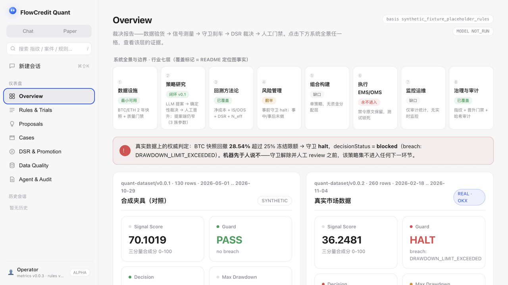
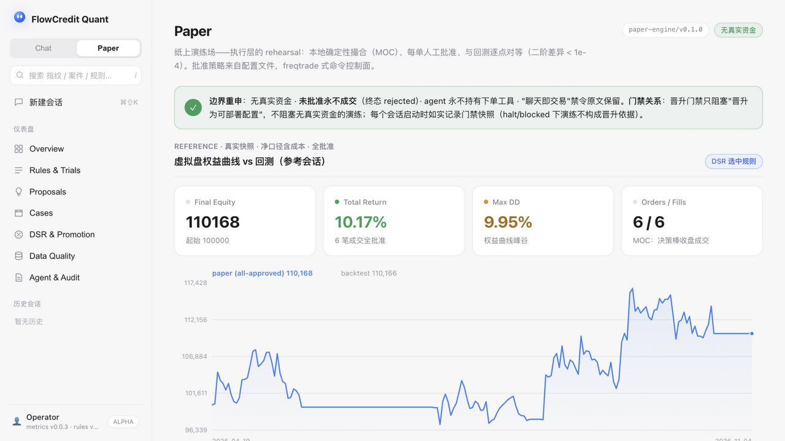
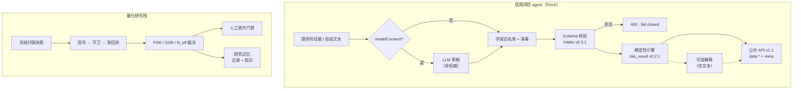

<div align="center">

# FlowCredit

**可审计的信用风险 agent · 确定性量化研究栈**

两条线，一个原则：**agent 形态，确定性灵魂** —— 模型可以说话，引擎做决定。

<sub>[English](README.md) · [简体中文](README.zh-CN.md)</sub>

[](https://github.com/Anhao1314/flowcredit/actions/workflows/ci.yml)
[](https://github.com/Anhao1314/flowcredit/releases)
[](docs/public-api-v1.md)
[](LICENSE)

[Finch 上架](https://finchtech.ai) · [公共 API](docs/public-api-v1.md) · [Finch 契约](docs/finch/CONTRACT.md) · [量化栈](quant/README.md) · [研究记忆](quant/research-memory/README.md)

</div>

---

## 这是什么

FlowCredit 是"治理优先"的风险系统，有两个面：

- **信用风险 agent**（上架 Finch 的公开产品）：把客户提供的经营证据转成确定性风险信号——TAI、CCI、风险等级、复核状态——外加一份"下一步该补什么"的清单。可选 LLM 侧车只做抽取与解释，永远不碰分数、等级和决策。
- **确定性量化研究栈**（`quant/`）：信号 → 守卫 → 净成本回测 → PSR/DSR 裁决 → 人工晋升，配套提案循环、CoALA 风格研究记忆、纸面/testnet 执行与本地控制台。

两条线遵守同一条规则：**权威数字来自纯函数，模型只做注记。**

零业务共享 Agent Core 位于 [`agent/core/`](agent/core/README.md)：统一 OpenAI 兼容 JSON/SSE 网关、封闭工具注册表、显式策略 TTL 会话、受校验的运行投影、通用审计事件和版本化原子检查点；信用与量化仍保留各自产品适配器和确定性引擎。

## 当前状态

| | |
| --- | --- |
| **仓库版本** | `external-alpha-v0.2.3` · agent `0.4.3` · API `flowcredit.api/v1.1` |
| **线上部署** | `external-alpha-v0.1.1` —— 升级到 v0.2.1 是待执行的运营动作 |
| **Finch** | 已上架 [finchtech.ai](https://finchtech.ai)，名称 *FlowCredit － Business Risk Intelligence*（[agent card](https://www.finchtech.ai/a2a/e96e9a01-50aa-4686-bd0e-1aa9cdfcf967/agent-card.json)） |
| **风险引擎** | `flowcredit.risk_result/v0.2.1` · intake `flowcredit.intake/v0.3.1` |
| **测试** | agent 107/107 · quant 157/157 · 隔离 lint 0 违规 |
| **诚实的结论** | 没有任何量化候选通过显著性检验（最佳 PSR(0) 0.942 < 0.95）——这是一个"证伪器"，不是印钞机 |

## 产品界面

<p align="center">
  
  
</p>

<p align="center"><sub>本地控制台：裁决总览（左）与带人工批准门禁的纸面交易演练（右）。</sub></p>

## 两条线，一条边界



两条线共享同一组不变式：

1. **权威边界** —— LLM 输出永不写入权威字段。
2. **人工门禁** —— 晋升/签字必须人工完成，机器永不自我升格。
3. **可审计** —— 指纹、eval ID、追加只写日志、证据定位符。
4. **无执行层** —— 不做 EMS/OMS、无真实资金；testnet 资金是假的。
5. **诚实披露** —— 缺证据就说缺，不编造。

## 线一 · 信用风险 agent

### 公共 API v1.1

| 端点 | 用途 |
| --- | --- |
| `POST /api/v1/assess` | 确定性评估 · canonical 信封 · 可选 `meta` |
| `POST /api/v1/chat` | 自然语言输入 → 同一确定性运行时 |
| `GET /api/v1/schema` | 机器可读的输入/输出 JSON Schema + 版本 |
| `GET /api/v1` · `/health` · `/ready` | 发现、存活、确定性就绪（无模型也可用） |
| `POST /fc/ai/v0.3/*` | 内部兼容面 |

```http
POST https://flowcredit-api.onrender.com/api/v1/assess
Authorization: Bearer <FLOWCREDIT_API_KEY>
Content-Type: application/json
Idempotency-Key: <可选客户端 key>
```

<details>
<summary><b>canonical 响应结构</b></summary>

```json
{
  "ok": true,
  "apiVersion": "flowcredit.api/v1.1",
  "schemaVersion": "flowcredit.risk_result/v0.2.1",
  "requestId": "fc-example",
  "timestamp": "2026-09-10T00:00:00.000Z",
  "data": {
    "TAI": 93.8,
    "CCI": 929,
    "riskGrade": "A",
    "decisionStatus": "enhanced-review",
    "readinessStatus": "ready",
    "inputFingerprint": "sha256:…",
    "assessmentFingerprint": "sha256:…"
  },
  "meta": {
    "release": "external-alpha-v0.2.3",
    "engine": "flowcredit.risk_result/v0.2.1",
    "intake": "flowcredit.intake/v0.3.1",
    "modelLayer": { "used": false }
  }
}
```

`meta` 是信封元数据，不参与 `assessmentFingerprint`，v1 客户端可安全忽略。

</details>

### 引擎算什么

```text
TAI (0–100)  = reconciliation×10% + validity×35% + physical×25%
             + commercial×20% + continuity×10%

CCI (0–1000) = round((TAI×40% + repayment×25% + customer×15%
               + economics×10% + continuity×10%) × 10)
```

必需分量缺失时输出 `null`，不重新分配权重。`PD_pct`、`expectedLoss`、`recommendedLimit` 永远为 `null`——系统不放贷、不定额度、不执行交易。

### 它拒绝做什么

| 拒绝事项 | 强制手段 |
| --- | --- |
| 让模型写分数/等级/决策 | 字段白名单 + 消毒器 + JSON Schema，测试锁死 |
| 编造缺失证据 | 不可计算值保持 `null`，如实报告 |
| 自动批准/拒绝信贷 | 输出结构里根本不存在这类字段 |
| 依赖模型才能运行 | 确定性路径与 `/ready` 与模型无关 |
| 暴露堆栈 | 只返回 canonical 错误信封 |

## 线二 · 确定性量化研究栈

| 层 | 能力 |
| --- | --- |
| **核心** | 信号引擎 · 事前守卫 · 净成本回测 · Sharpe / MaxDD / 换手 |
| **裁决** | PSR · deflated Sharpe（SSRN 2460551 Eq. 2）· 有效试验数（A.3）· 分段稳健性 |
| **提案循环** | LLM 候选 → 边界/去重 → 同池多市场裁决 → 报告 |
| **记忆** | 经历式 journal（JSONL）· 语义知识（校验后）· 证据派生记录 + 预览 |
| **执行演练** | 本地纸面引擎 · Binance Spot **testnet** 适配器 · 逐单人工批准 |
| **界面** | 本地控制台（8 视图、搜索、可排序表格）· MCP server（7 工具，无下单工具） |

### 研究现状

| 指标 | 结果 | 阈值 |
| --- | --- | --- |
| 最佳 PSR(0) | **0.942**（ETH） | ≥ 0.95 · ✗ |
| 跨市场方向一致 | 3/4 候选 | 4/4 · ✗ |
| 分段稳健 | 正窗比例 0.50–0.75 | 全市场 ≥ 0.75 · ✗ |
| 校准成本 | BTC 13.47bps · ETH 15.29bps | 冻结 7bps 偏乐观约 2 倍 |

所有失败都保留在研究记忆里——系统的职责是快速、可审计地证明**什么不行**。

## 验证

| 检查 | 结果 |
| --- | --- |
| Agent 测试 | **107/107** |
| Quant 测试 | **157/157** |
| 隔离 lint | **0 违规**（62 文件） |
| 契约校验 | `validate:public-api` · `validate:finch-contract` 通过 |
| 发布门禁 | `verify:release` · `verify:finch-submission` 在无 `.env` 干净树通过 |
| 离线 agent 评估 | 30 个合成用例 · 4 组注入对照 · `ONLINE_MODEL=NOT_RUN` |

## 快速开始

**Agent**（确定性路径不需要模型 key）：

```bash
cd agent
npm ci
npm run check          # 语法 + 类型 + 107 测试
npm start              # http://127.0.0.1:8787

curl -X POST http://127.0.0.1:8787/api/v1/assess \
  -H 'Content-Type: application/json' \
  --data-binary @contracts/finch-test-input.json
```

**量化栈**（全离线；完整指南见 [`quant/README.md`](quant/README.md)）：

```bash
cd agent
npm run test:quant     # 157 测试
npm run check:quant    # 隔离 lint
npm run memory         # 研究记忆预览 + 知识库
npm run console        # 构建 quant/console/index.html
npm run adjudicate     # 确定性裁决
```

## 仓库地图

| 路径 | 内容 |
| --- | --- |
| `agent/` | Finch agent：HTTP 服务、intake、风险引擎、可选 LLM harness、校验器 |
| `agent/contracts/` | 输入/输出 JSON Schema + 代表性夹具 |
| `quant/` | 确定性研究栈（信号→守卫→回测→裁决→纸面/MCP/控制台） |
| `quant/research-memory/` | 证据派生记忆：记录、知识、`memory-preview.md` |
| `quant/journal/`、`quant/knowledge/` | 经历式（追加只写 JSONL）与语义（校验后 JSON）记忆 |
| `docs/` | 当前文档 · `docs/archive/` 历史材料 · `docs/finch/` 上架包 |
| `deploy/` | 替代部署示例（生产使用 Render） |

## 数据与许可

- Agent 只消费**提供的**证据——没有银行、账单、身份或链上连接器。
- 量化行情是冻结的本地研究数据。新增下载受许可登记约束：Binance Vision **CC BY-NC-SA 4.0**、Coin Metrics **CC BY-NC 4.0**、OKX 条款未核验 → **不新增下载**；现有快照不对外重发布。详见 [`quant/data/LICENSING.md`](quant/data/LICENSING.md)。

## 限制

- 无生产级信用校准、无校准 PD / 预期损失 / 数值额度、无 SLA。
- 无在线模型评估（`ONLINE_MODEL=NOT_RUN`）。自由文本抽取已接入原文 grounding：原文无依据的字段在进入校验前丢弃；JSON intake 没有原文，依赖调用方提供字段。证据状态单独披露（`evidenceStatus`，`basis: declared_only`，当前没有独立验证证据）。
- 量化：无统计显著策略；无真实资金；testnet 资金是假的。
- 不是通用 agent 运行时、多 agent 集群或交易机器人。

## 文档

| | |
| --- | --- |
| API 与规则 | [公共 API](docs/public-api-v1.md) · [风险规则 v0.2.1](docs/flowcredit-rules-v0.2.1.md) · [intake v0.3](docs/flowcredit-intake-v0.3.md) |
| Finch | [契约](docs/finch/CONTRACT.md) · [提交包](docs/finch/SUBMISSION.md) · [上架文案](docs/finch/LISTING.md) · [交接指南](docs/finch/FINCH_HANDOFF_GUIDE.md) |
| 发布 | [external-alpha-v0.2.3](docs/releases/external-alpha-v0.2.3.md) · [v0.1.1](docs/releases/external-alpha-v0.1.1.md) |
| 产品 | [Enterprise PRD v0.1](docs/product/enterprise-prd-v0.1.md) · [Design Partner 候选](docs/product/design-partner-candidates-v0.1.md) |
| 量化 | [量化栈](quant/README.md) · [研究记忆](quant/research-memory/README.md) · [许可](quant/data/LICENSING.md) |
| 参与 | [贡献指南](CONTRIBUTING.md) · [安全策略](SECURITY.md) · [变更日志](CHANGELOG.md) · [归档](docs/archive) |

## 由来

起源于深圳—香港黑客松，之后作为赛后产品化项目继续。私有历史仓库 `DEMO.FlowCredit` 保留原始模拟界面；本仓库是当前项目。

<div align="center">

**MIT 许可** · 以证据优先于热情的方式构建。

</div>
